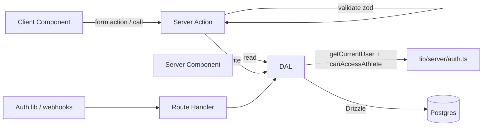

# API and data access

[Fact] No data access code exists. [Proposed] The design below follows [ADR-008](../00_meta/decision_log.md#adr-008-data-access-layer) and [ADR-009](../00_meta/decision_log.md#adr-009-mutation-mechanism).

## Layers



## Data Access Layer (`lib/server/dal/*.ts`)

- One module per aggregate: `relationships.ts`, `exercises.ts`, `programs.ts`, `logs.ts`, `videos.ts`, `feedback.ts`, `dashboard.ts`.
- Every exported function:
  1. resolves the user with `getCurrentUser()` (or receives a `user` from a caller that has already done so in the same request),
  2. authorizes (see [authentication_and_authorization.md](authentication_and_authorization.md#authorization-model)),
  3. runs the query or mutation,
  4. returns a **DTO**: a plain, serializable object containing only the fields the UI needs.
- Reads that need several queries use `Promise.all` to avoid waterfalls.
- Multi-row writes (reordering, duplicating a week, completing a session) run inside a single transaction.

Example signatures (illustrative):

```ts
getAthleteProgram(programId: string): Promise<ProgramDTO>            // read
getSessionForLogging(sessionId: string): Promise<SessionLoggingDTO>   // read, athlete
logPerformedSet(input: LogSetInput): Promise<PerformedSetDTO>         // athlete-write
updatePrescribedSet(input: UpdatePrescribedSetInput): Promise<void>   // coach-write, lock check
```

## Server Actions (`app/**/actions.ts`)

- Each action file starts with `"use server"`, and its exported functions are colocated with the route that uses them.
- Pattern: **parse → call DAL → revalidate → return result**.

```ts
"use server";
export async function logSetAction(_prev: ActionResult, formData: FormData): Promise<ActionResult> {
  const parsed = logSetSchema.safeParse(Object.fromEntries(formData));
  if (!parsed.success) return { ok: false, fieldErrors: z.flattenError(parsed.error).fieldErrors };
  await logPerformedSet(parsed.data);         // throws on authz failure
  revalidatePath(`/train/sessions/${parsed.data.sessionId}`);
  return { ok: true };
}
```

- The return type is a discriminated union, `ActionResult<T> = { ok: true; data?: T } | { ok: false; formError?: string; fieldErrors?: Record<string, string[]> }`.
- Actions never accept `userId`, `athleteProfileId`, or role from the client for authorization purposes.
- Actions are public HTTP endpoints. Treat every argument as untrusted input.

## Validation

- Use Zod (dependency to be added in F-00; [Proposed]). Schemas live in `lib/validation/` and are shared by forms (client-side hints) and actions (authoritative).
- Numeric domain constraints:

| Field | Rule |
| --- | --- |
| `weight_kg` | 0 ≤ x ≤ 1000, 2 decimal places max |
| `reps` | integer 0–100 |
| `rpe` / `target_rpe` | 1–10 in 0.5 steps |
| `percent_1rm` | 0 < x ≤ 120 |
| `rest_seconds` | integer 0–3600 |
| Text notes | ≤ 2000 characters, trimmed |

## Route Handlers

Route Handlers are allowed only for the auth library's endpoints (for example `app/api/auth/[...all]/route.ts`), storage provider webhooks if adopted, and cron endpoints. Each one must authenticate its caller (a session, a webhook signature, or a cron secret).

## Pagination

History lists (sessions, feedback) use keyset pagination on `(created_at, id)` with a page size of 20. Dashboards query bounded windows (for example, the last 14 days and the top 10 items).
