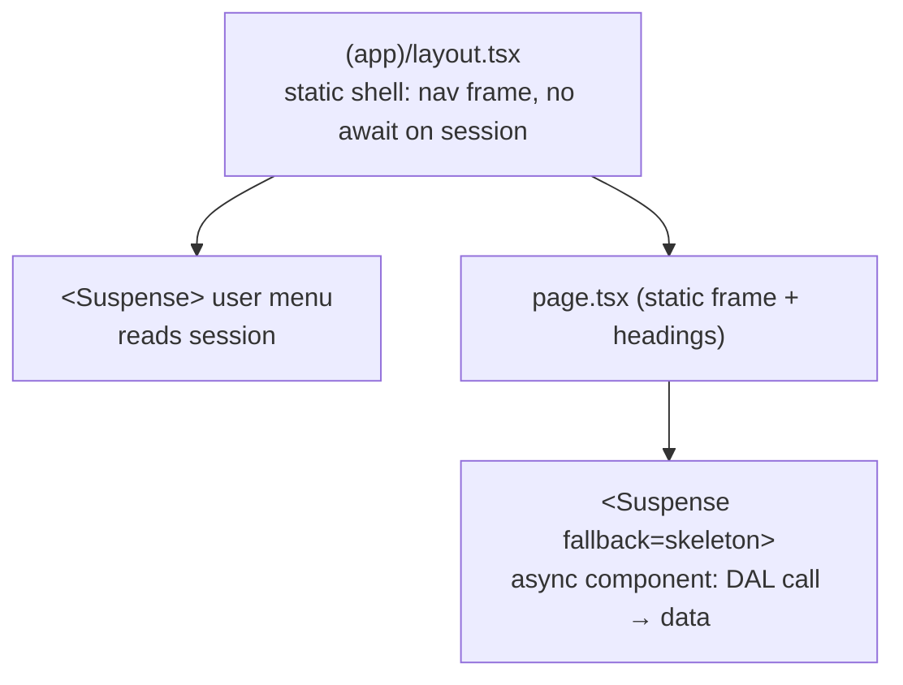

# Application architecture

## Folder structure

[Fact] The current folder structure:

```
app/            layout.tsx, page.tsx, globals.css, favicon.ico
public/         template SVGs
```

[Proposed] The target folder structure. Create folders only when the first file needs them.

```
app/
  (auth)/                 sign-in, sign-up, verify; public routes
  (app)/                  authenticated shell (layout with nav)
    dashboard/            role-aware landing page
    coach/
      athletes/                         roster
      athletes/[athleteId]/             athlete overview
      athletes/[athleteId]/programs/[programId]/   program editor
      reviews/                          videos awaiting review
    train/                              athlete: current program
      sessions/[sessionId]/             logging screen
    history/
    exercises/
    settings/
  api/                    route handlers (auth library, storage webhooks only)
components/
  ui/                     generic primitives (Button, Input, Dialog...)
  <domain>/               domain components (program-editor/, set-logger/...)
lib/
  server/                 server-only: db client, DAL modules, auth helpers
    db/                   schema + client + migrations config
    dal/                  programs.ts, logs.ts, videos.ts, ...
    auth.ts               getCurrentUser, requireRole, access checks
  validation/             zod schemas shared by forms and actions
  domain/                 pure functions (e1RM, deviation, unit conversion)
tests/                    e2e (Playwright); unit tests sit next to source files
```

Rules:

- `lib/server/**` modules start with `import "server-only"`. Adding the `server-only` package is part of F-00.
- `lib/domain/**` is pure TypeScript with no I/O, so the browser and the server can both use it.
- Route groups `(auth)` and `(app)` share no layout other than the root layout.
- One `dashboard/` route renders the coach and/or athlete panels based on the user's roles. This avoids duplicated routes for dual-role users.

## Rendering strategy

[Fact] `cacheComponents` is enabled. Under this mode (Next.js 16 docs: `01-app/02-guides/authentication-with-cache-components.md`):

- Request-time data (`cookies()`, `headers()`, and therefore the session) cannot be read outside a `<Suspense>` boundary. Doing so is a build error.
- Static and cached content prerenders into the static shell. Request-dependent content streams in.

[Proposed] How this application applies it:



- Layouts never `await` the session at the top level. Session-dependent pieces are components inside `<Suspense>`.
- Every page that shows user data wraps the data component in `<Suspense>` with a skeleton fallback that matches the final layout.
- `getCurrentUser()` uses `"use cache: private"` (or React `cache()` for per-request deduplication). Choose one in F-01 after checking the chosen auth library.
- **Do not** use `"use cache"` / `"use cache: remote"` for athlete data in the MVP. Cross-request server caching of private data adds invalidation and leakage risk for little benefit at MVP scale. The system exercise library is the exception: it is static and cacheable.
- After mutations, Server Actions call `revalidatePath`/`refresh` as appropriate. Tag-based invalidation is adopted only once `use cache` is used for private data.
- `partialPrefetching` is enabled, so links prefetch the route's App Shell. Use `<Link prefetch={true}>` sparingly. The obvious candidate is the athlete's "next session" link.

## Client vs server components

- Default to Server Components. Add `"use client"` only for interactivity: set logger inputs, drag-to-reorder, upload progress, and video player controls.
- Push `"use client"` as far down the tree as possible. Pass serializable props only.
- Client components never import from `lib/server/**`.

## Frontend/backend boundary

| Layer | May do | Must not do |
| --- | --- | --- |
| Client components | Render, local state, call Server Actions, upload to a presigned URL | Import server modules, hold secrets, decide authorization |
| Server Components | Call DAL read functions, render | Query the DB directly, mutate |
| Server Actions | Validate input, call DAL write functions, revalidate | Query the DB directly, trust client-provided user or role IDs |
| Route Handlers | Serve external callers (auth, webhooks) | Duplicate Server Action logic |
| DAL (`lib/server/dal`) | Authenticate, authorize, query, and return DTOs | Return raw DB rows with fields the caller should not see |

Details are in [api_and_data_access.md](api_and_data_access.md).
