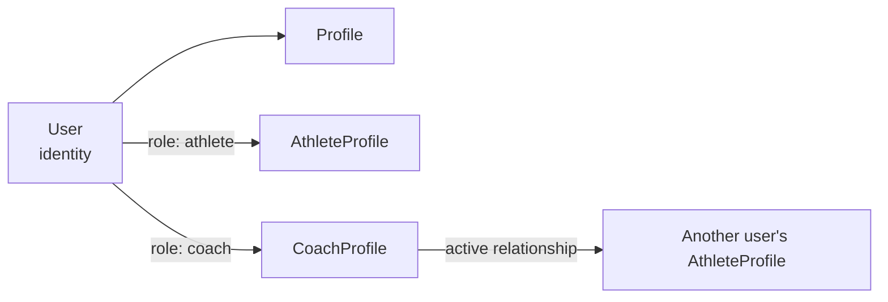

# Authentication and authorization

[Fact] No authentication exists. [Proposed] Everything below is the target design. The provider is [Open] ([Q-004](../00_meta/open_questions.md#q-004-authentication-provider)).

## Authentication

- Email and password with email verification, and password reset by email. OAuth comes later.
- Sessions use HTTP-only, `Secure`, `SameSite=Lax` cookies. Session records are stored server-side in the database (when using a self-hosted library).
- Next.js 16 uses `proxy.ts` (formerly `middleware.ts`). It may perform an **optimistic** redirect of unauthenticated requests away from `(app)` routes, but it is **never** the authorization boundary. Every DAL call re-checks.
- Unverified users can sign in but cannot create relationships or programs.

## Identity vs roles



- A role is defined by the **existence of a profile row**. There is no separate roles column, so the two cannot drift out of sync.
- A user with both profiles uses one account. The UI shows both dashboards.
- Self-coaching does not need a relationship: an athlete may author programs for their own `AthleteProfile`.

## Authorization model

All checks run in the DAL (`lib/server/auth.ts` + `lib/server/dal/*`). The core primitive is:

```
canAccessAthlete(user, athleteProfileId, mode: "read" | "coach-write" | "athlete-write")
```

| Mode | Granted when |
| --- | --- |
| `read` | the user owns the athlete profile, **or** the user's coach profile has an `active` relationship with it |
| `coach-write` | there is an `active` relationship (coach), **or** the user owns the profile and is self-coaching the program in question |
| `athlete-write` | the user owns the athlete profile |

Program-level writes also require `program.author_user_id = user.id`, or an active coach relationship for the program's athlete. This lets a coach take over a program the athlete authored ([Open] whether this should be allowed: the default is yes).

## Permission matrix

| Action | Athlete (self) | Active coach | Former/pending coach | Other user |
| --- | --- | --- | --- | --- |
| View own profile and dashboard | ✅ | n/a | n/a | ❌ |
| View the athlete's programs | ✅ | ✅ | ❌ | ❌ |
| Create or edit a program for the athlete | ✅ only if self-coached or the athlete is the author | ✅ | ❌ | ❌ |
| Edit a prescription after logging has started | ❌ | ❌ ([Q-013](../00_meta/open_questions.md#q-013-editing-prescriptions-after-logging-starts)) | ❌ | ❌ |
| Create or edit a session log or performed sets | ✅ | ❌ | ❌ | ❌ |
| Upload or delete a video | ✅ | ❌ | ❌ | ❌ |
| Watch a video | ✅ | ✅ | ❌ | ❌ |
| Mark a video reviewed | ❌ | ✅ | ❌ | ❌ |
| Post feedback | ✅ (reply) | ✅ | ❌ | ❌ |
| Edit or delete feedback | ✅ own comments | ✅ own comments | ❌ | ❌ |
| Record a reference max | ✅ | ✅ | ❌ | ❌ |
| Invite an athlete | n/a | ✅ (coach role required) | | |
| End a relationship | ✅ | ✅ | | |

## Rules

- **AUTH-001.** User identity comes only from the server session. IDs in the request (form fields, params) say *what* to act on, never *who* is acting.
- **AUTH-002.** Every DAL function authorizes before querying or mutating. Return `notFound()` (not 403) for resources the user cannot see, so that resources cannot be enumerated.
- **AUTH-003.** Access is re-evaluated on every request. Nothing is cached across requests, so ending a relationship revokes access immediately.
- **AUTH-004.** Child resources (a set, a video, a comment) are authorized by resolving their `athlete_profile_id` server-side, never by trusting a parent ID supplied by the client.
- **AUTH-005.** Video files follow the same rules. Signed URLs are issued only after `canAccessAthlete(..., "read")` passes ([video_storage_and_delivery.md](video_storage_and_delivery.md#authorization)).
- **AUTH-006.** DTOs returned to the client contain only the fields needed. No other user's emails appear unless the relationship requires them (for example, a pending invite shows the invited email to the coach).

## Defense in depth [Open]

Postgres Row-Level Security could back up the DAL checks. It is **not** recommended for the MVP when using a single application DB role with Drizzle, because it duplicates logic. Reconsider if the database is ever reached from outside the app (for example, Supabase client SDKs).
