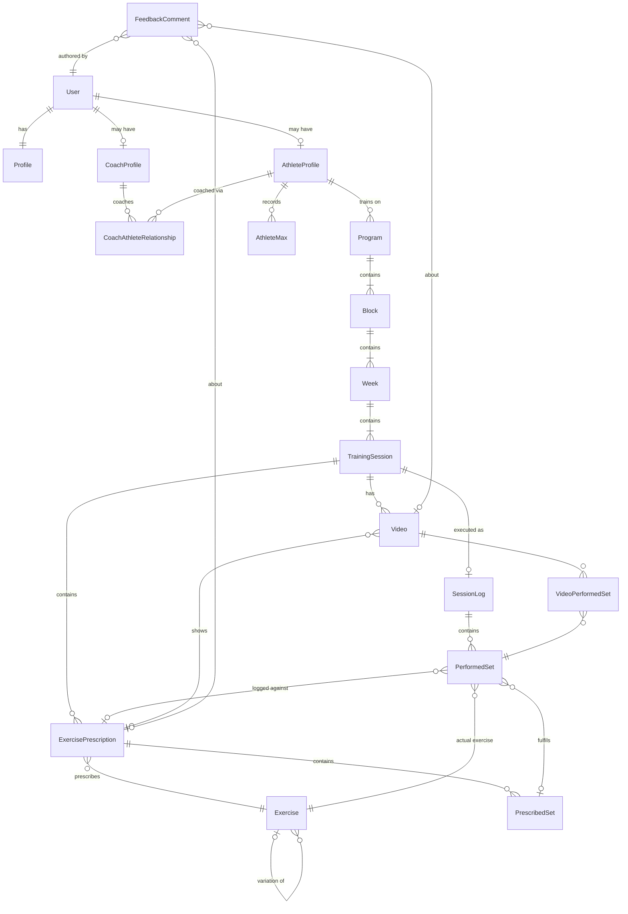

# Data model

[Proposed] No schema exists yet. This is the target logical model. Column types assume PostgreSQL ([Q-001](../00_meta/open_questions.md#q-001-database-and-hosting)). Domain rules are in [03_business_domain/](../03_business_domain/).

## Entity relationships

## Ownership

| Entity group | Owner (writer) | Readers |
| --- | --- | --- |
| `User`, `Profile` | the user | self; a coach or athlete in an active relationship (name and avatar only) |
| `CoachAthleteRelationship` | created by the coach, accepted or declined by the athlete, ended by either | both parties |
| `Program` … `PrescribedSet` | the program **author** (the active coach, or the athlete if self-coached) | the athlete and the active coach |
| `Exercise` (system) | migrations/seed only | everyone |
| `Exercise` (custom) | the creator | the creator, and athletes whose programs use it |
| `AthleteMax` | the athlete or the active coach | the athlete and the active coach |
| `SessionLog`, `PerformedSet` | **the athlete only** | the athlete and the active coach |
| `Video` | the athlete (upload/delete); the coach (review status) | the athlete and the active coach |
| `FeedbackComment` | its author | the athlete and the active coach |

## Entities

Common columns on every table: `id uuid pk`, `created_at timestamptz`, `updated_at timestamptz`. Soft delete (`deleted_at`) is used only where noted.

### Identity

- **User:** the shape is determined by the auth library ([Q-004](../00_meta/open_questions.md#q-004-authentication-provider)). It includes at least `email` (unique) and `email_verified`.
- **Profile:** `user_id` (unique FK), `display_name`, `timezone` (IANA name, used for "today"), `weight_unit` (`kg|lb`, display only).
- **AthleteProfile:** `user_id` (unique FK), optional `bodyweight_kg` and `weight_class`.
- **CoachProfile:** `user_id` (unique FK), optional `bio`.
- **CoachAthleteRelationship:** `coach_profile_id`, `athlete_profile_id`, `status` (`pending|active|declined|ended`), `invited_email`, `started_at`, `ended_at`.
  Constraint: a partial unique index allowing at most one `active` relationship per athlete ([Q-003](../00_meta/open_questions.md#q-003-multiple-coaches-per-athlete)).

### Programming (planned)

- **Program:** `athlete_profile_id`, `author_user_id`, `name`, `description`, `status` (`draft|active|completed|archived`), `start_date` (nullable).
  Constraint: at most one `active` program per athlete.
- **Block:** `program_id`, `position`, `name`, `goal` (free text).
- **Week:** `block_id`, `position`, `label` (nullable, defaults to "Week N"), `notes`.
- **TrainingSession:** `week_id`, `day_index`, `name`, `scheduled_date` (nullable), `coach_notes`.
- **Exercise:** `name`, `lift_category` (`squat|bench|deadlift|other`), `parent_exercise_id` (nullable), `is_system`, `owner_user_id` (null for system exercises), `archived_at`.
  Uniqueness: (`owner_user_id`, lower(`name`)).
- **ExercisePrescription:** `training_session_id`, `exercise_id`, `position`, `rest_seconds`, `tempo`, `instructions`, `coach_notes`.
- **PrescribedSet:** `exercise_prescription_id`, `set_number`, `reps_min`, `reps_max` (equal for a fixed rep count), `is_amrap`, `target_rpe numeric(3,1)`, `percent_1rm numeric(5,2)`, `weight_kg numeric(6,2)`, `label` (for example "top", "back-off").
  Each set may carry any combination of RPE, %1RM, and weight. All of them may be null (for example "3×10, pick a weight").
- **AthleteMax:** `athlete_profile_id`, `exercise_id`, `weight_kg`, `kind` (`tested|estimated|manual`), `recorded_on`.

### Execution (performed)

- **SessionLog:** `training_session_id` (unique), `athlete_profile_id`, `status` (`in_progress|completed|skipped`), `started_at`, `completed_at`, `notes`, `bodyweight_kg`, `session_rpe` (nullable).
- **PerformedSet:** `session_log_id`, `exercise_prescription_id` (nullable for an exercise the athlete added), `prescribed_set_id` (nullable for an extra set), `exercise_id` (the exercise actually performed; it differs from the prescription for a substitution), `set_number`, `status` (`completed|skipped`), `weight_kg`, `reps`, `rpe numeric(3,1)`, `notes`, `logged_at`.
  Constraint: a `prescribed_set_id` is unique among non-deleted rows, so a prescribed set is fulfilled at most once.

### Review

- **Video:** `athlete_profile_id`, `training_session_id`, `exercise_prescription_id` (nullable), `uploaded_by_user_id`, `storage_key` (unique, never exposed as a public URL), `content_type`, `size_bytes`, `duration_seconds`, `original_filename`, `upload_status` (`pending|uploaded|ready|failed`), `failure_reason`, `review_status` (`awaiting_review|reviewed`), `reviewed_at`, `reviewed_by_user_id`, `deleted_at`.
- **VideoPerformedSet:** (`video_id`, `performed_set_id`) composite PK.
- **FeedbackComment:** `athlete_profile_id` (denormalized for authorization), `author_user_id`, `training_session_id`, `exercise_prescription_id` (nullable), `video_id` (nullable), `video_timestamp_seconds` (nullable), `body`, `edited_at`, `deleted_at`.
  Check: `exercise_prescription_id` or `video_id` must be present.
- **ThreadReadMarker** (F-10): `user_id`, `thread_key` (for example `video:<id>`), `last_read_at`.

## Design notes

- **Denormalized `athlete_profile_id`.** Log, video, and feedback tables carry `athlete_profile_id` so that authorization is one indexed check instead of a six-level join.
- **Expanded sets.** Prescribed sets are stored one row per set, not as "3×5" groups. This makes 1:1 fulfilment linking and per-set targets straightforward. The UI provides "add N identical sets".
- **Positions.** `position` uses integers that are rewritten in a transaction on reorder. Fractional indexing is not needed at this scale.
- **History is immutable by construction.** Performance tables are never rewritten by program edits. Deleting a program that has logs is not allowed; archive it instead ([BR-PRG-007](../03_business_domain/training_programs.md#business-rules)).
- **Not modeled (MVP).** Supersets/circuits, warm-up sets as a distinct type (use `label`), templates, and organizations.
