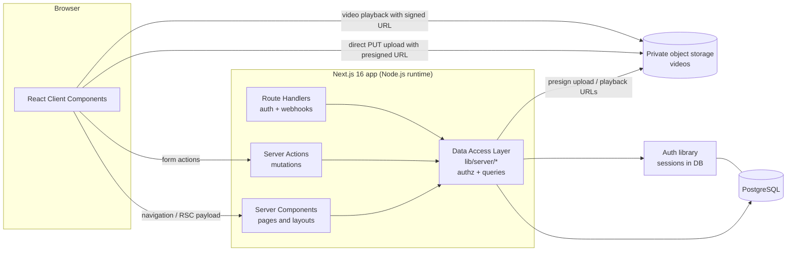

# System overview

## Current state [Fact]

The repository is a `create-next-app` scaffold:

| Concern | Current state |
| --- | --- |
| Framework | Next.js 16.4.0, App Router (`app/`), no `src/` directory |
| UI runtime | React 19.3.0 / React DOM 19.3.0 |
| Language | TypeScript 5.9, `strict: true`, path alias `@/*` → repository root |
| Styling | Tailwind CSS 4.3 through the `@tailwindcss/turbopack` loader (configured in `next.config.ts` turbopack rules; there is no PostCSS config). Theme tokens are in `app/globals.css`. |
| Fonts | Geist and Geist Mono through `next/font/google` |
| Next config | `cacheComponents: true`, `partialPrefetching: true`, `experimental.agentFeedback: true` |
| Linting | ESLint 9 flat config, using `eslint-config-next` core-web-vitals and typescript presets |
| Database / ORM | None |
| Authentication | None |
| File storage | None |
| Tests | None |
| Deployment | Not configured (no `vercel.json`, CI, or Docker files) |
| Version control | The directory is **not** a git repository |

## Target architecture [Proposed]

Key properties:

- **One deployable unit.** Next.js serves both the UI and the server logic. There is no separate backend service in the MVP.
- **Server-side authorization.** The DAL is the only path to data. Client code never receives data it is not allowed to see. See [authentication_and_authorization.md](authentication_and_authorization.md).
- **Videos bypass the app server.** Uploads go straight from the browser to object storage, so large bodies never pass through server functions. See [video_storage_and_delivery.md](video_storage_and_delivery.md).
- **Node.js runtime everywhere.** Edge runtime is not used.

## Document map

| Topic | Document |
| --- | --- |
| Folder layout, rendering, caching | [application_architecture.md](application_architecture.md) |
| Entities and relationships | [data_model.md](data_model.md) |
| Sessions, roles, permission matrix | [authentication_and_authorization.md](authentication_and_authorization.md) |
| Upload and playback flows | [video_storage_and_delivery.md](video_storage_and_delivery.md) |
| Server Actions, DAL, validation | [api_and_data_access.md](api_and_data_access.md) |
| Error types, logging | [error_handling.md](error_handling.md) |

## Observability [Proposed]

The MVP is kept minimal:

- Server errors are logged with structured `console.error` (Vercel captures function logs) and include a request-scoped error ID shown to the user.
- `instrumentation.ts` is reserved for adding OpenTelemetry or an error tracker later. No vendor is chosen.
- Logs never contain set data, notes, video URLs, tokens, or emails. See [security.md](../02_coding_standards/security.md).
