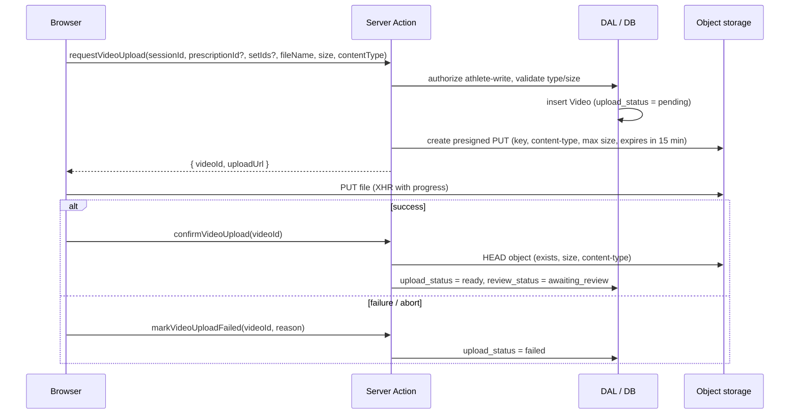
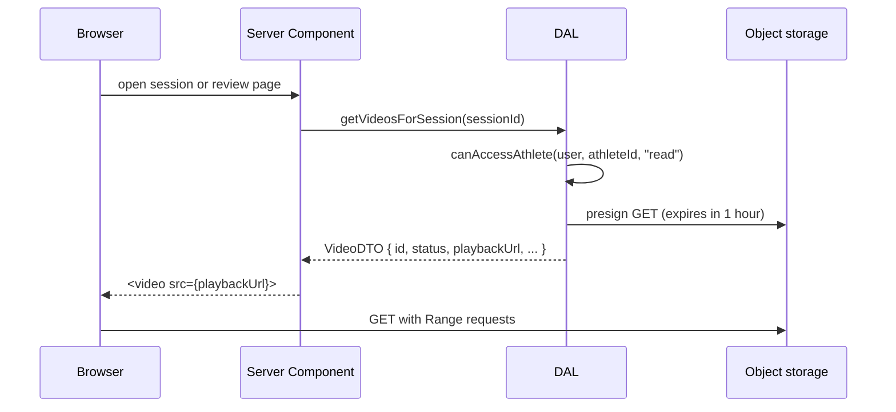

# Video storage and delivery

[Fact] No storage is configured. [Proposed] This is the target design. The provider is [Open] ([Q-005](../00_meta/open_questions.md#q-005-video-object-storage)). The design assumes an S3-compatible API with presigned URLs. Vercel Blob private stores, Supabase Storage, and R2 all support an equivalent flow.

Domain rules are in [video_review_and_feedback.md](../03_business_domain/video_review_and_feedback.md).

## Why video files are not stored in the database

Lift videos from phones are typically 20–400 MB. Storing them in Postgres would bloat backups and prevent CDN delivery and HTTP range requests (seeking). Serverless request bodies are also size-limited (Vercel Functions reject request bodies over 4.5 MB), so uploads cannot pass through Server Actions. **Only metadata is stored in the database. Files go to a private object storage bucket.**

## Storage layout

- **Private bucket.** No public read access and no listing.
- **Key format:** `videos/{athleteProfileId}/{videoId}/{random}.{ext}`. Keys are unguessable and never shown in the UI.
- **CORS.** Allow `PUT` from the app's origins only.

## Upload flow

- **Validation.** Accept `video/mp4` and `video/quicktime` only. The default maximum is 500 MB ([Q-016](../00_meta/open_questions.md#q-016-video-retention-and-limits)). Validate on the client for UX, again when presigning, and again on confirm (HEAD). The server's check is authoritative.
- **Duration.** Read client-side from the `<video>` element's metadata before upload. Treat it as advisory, because it cannot be verified without processing.
- **Retry.** A `failed` or stale `pending` video can be retried. Retrying issues a new presigned URL for the **same** `videoId` and key.
- **Cleanup.** A scheduled job (cron) deletes `pending` records older than 24 hours and any matching objects. [Open] Whether to use the host's cron (for example, Vercel Cron) depends on [Q-006](../00_meta/open_questions.md#q-006-hosting-platform). Until that is decided, stale rows are harmless and are hidden from the UI.
- **Resumable uploads.** Not in the MVP. Multipart or resumable upload is the first upgrade if large uploads on gym Wi-Fi fail often.
- **Processing.** There is no transcoding in the MVP ([Q-009](../00_meta/open_questions.md#q-009-video-transcoding)). `uploaded` is a transient state between the PUT and the HEAD verification. A video becomes `ready` after a successful HEAD verification.

## Playback flow

## Authorization

Two layers must both hold:

1. **Metadata.** `Video` rows are returned only by DAL functions that pass `canAccessAthlete(..., "read")` ([AUTH-005](authentication_and_authorization.md#rules)).
2. **File.** The file is reachable **only** through a presigned GET URL generated after check 1.
   - Lifetime is ≤ 1 hour, which is long enough to watch the video and short enough to limit leakage.
   - URLs are generated per request and are never stored in the database or cached across users.
   - Revoking access (by ending a relationship) prevents new URLs from being issued. Already-issued URLs remain valid until they expire. This window is accepted and documented.
   - Never set `Cache-Control: public` on responses that contain playback URLs.

## Deletion

- An athlete deletes a video: soft-delete the row (`deleted_at`) and delete the object right away. Feedback comments attached to the video remain, and the video is shown as "Video deleted".
- An account is deleted: all of the athlete's objects are deleted. [Open] An account deletion flow is not yet specified.

## Playback compatibility

HEVC `.mov` files from iPhones may not play in every browser. If the `<video>` element fires an `error` event, the UI shows "This browser can't play this video" with a download link (using the same signed URL). Track occurrences to decide on transcoding.
