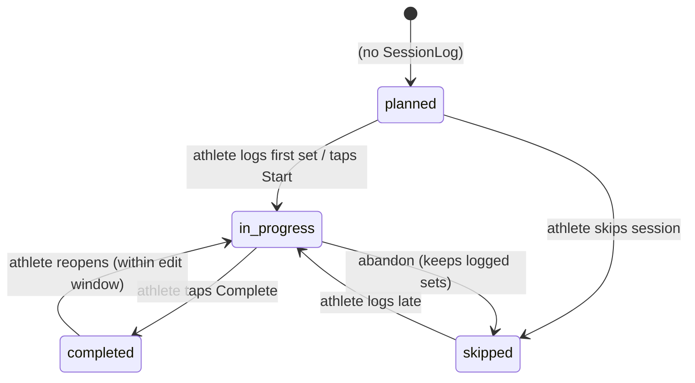

# Training execution and logging

Entities: `SessionLog` and `PerformedSet` ([data_model.md](../01_architecture/data_model.md#execution-performed)). Prescriptions are defined in [exercises_and_prescriptions.md](exercises_and_prescriptions.md).

## Core principle

[Requirement] **Prescribed and performed data are separate records** ([ADR-004](../00_meta/decision_log.md#adr-004-separate-prescription-and-performance)). The athlete writes only performance tables. Logging cannot modify a prescription, because the athlete has no write path to prescription tables.

## Why set-level logging

[Proposed] Set-level logging is the default granularity ([ADR-006](../00_meta/decision_log.md#adr-006-set-level-logging)):

- Powerlifting prescriptions vary from set to set (a top set followed by back-offs), so an exercise-level summary loses the most important information.
- RPE, which drives autoregulation and e1RM, is meaningful only per set.
- Videos and feedback often refer to a specific set ("set 3 your hips shot up").
- Exercise-level and session-level summaries can always be derived from set data. The reverse is impossible.

The cost is extra input, which is mitigated by prefilling each set with its prescribed values and providing a one-tap "done as prescribed".

## Session lifecycle

`planned` and `missed` are derived states; they are never stored.

## What the athlete records

| Item | Where | Required |
| --- | --- | --- |
| Actual weight (kg) | `PerformedSet.weight_kg` | Yes for completed sets (0 is allowed for bodyweight) |
| Actual reps | `PerformedSet.reps` | Yes for completed sets |
| Actual RPE | `PerformedSet.rpe` | Optional |
| Completed or skipped set | `PerformedSet.status` | Yes |
| Set note / deviation reason | `PerformedSet.notes` | Optional |
| Substituted exercise | `PerformedSet.exercise_id` ≠ the prescribed exercise | Optional |
| Extra set | `PerformedSet` with `prescribed_set_id = null` | Optional |
| Extra exercise | `PerformedSet` with `exercise_prescription_id = null` | Optional |
| Session notes, bodyweight, session RPE | `SessionLog` | Optional |
| Session completion | `SessionLog.status` | Yes |

**Modified sets** are not a stored status. A set counts as *modified* when its performed values differ from its prescription (reps outside the range, load different from the resolved target by more than 2.5 kg, RPE more than 0.5 above the target, or a substituted exercise). The comparison logic lives in `lib/domain/deviation.ts` and is unit-tested.

## Business rules

| ID | Rule | Status |
| --- | --- | --- |
| BR-LOG-001 | Only the athlete who owns the profile writes `SessionLog` and `PerformedSet`. A coach cannot log on an athlete's behalf (MVP). | [Proposed] |
| BR-LOG-002 | Only sessions in an `active` program can be logged. | [Proposed] |
| BR-LOG-003 | Creating the first performed set or tapping Start creates the `SessionLog` (`in_progress`). This locks the session's prescriptions (BR-PRG-006). | [Proposed] |
| BR-LOG-004 | Each set is saved individually as it is logged. There is no "save session" step that could lose data. | [Proposed] |
| BR-LOG-005 | A prescribed set is fulfilled by at most one performed set. Extra sets have no `prescribed_set_id`. | [Proposed] |
| BR-LOG-006 | Completing a session with unlogged prescribed sets asks the athlete to confirm. Those sets remain *unlogged* (not auto-skipped) unless the athlete chooses "mark remaining as skipped". | [Proposed] |
| BR-LOG-007 | The athlete can edit their performed sets and notes for 7 days after `completed_at` ([Open] the length of the window). After that, the log is read-only. | [Proposed] |
| BR-LOG-008 | Sessions can be logged out of order and late. `started_at` and `completed_at` record when training actually happened. | [Proposed] |
| BR-LOG-009 | Unsent set input survives a page reload (local draft per session, [Q-011](../00_meta/open_questions.md#q-011-offline-logging)). | [Proposed] |
| BR-LOG-010 | A logged set with RPE 10 and reps below the prescribed minimum is a valid result (a missed rep), not a validation error. | [Proposed] |

## Example

Prescription: Competition Squat, 1×3 @ RPE 8 and 3×5 @ 75% (max 200 kg → 150 kg).

| Set | Prescribed | Performed | Interpretation |
| --- | --- | --- | --- |
| 1 | 3 @ RPE 8 | 170 kg × 3 @ 8.5 | Completed, RPE slightly above target (modified) |
| 2 | 5 @ 150 kg | 150 × 5 @ 7 | As prescribed |
| 3 | 5 @ 150 kg | 150 × 5 @ 7.5 | As prescribed |
| 4 | 5 @ 150 kg | skipped, note "knee felt off" | Skipped |
| — | — | 120 × 8 (Box Squat, extra set) | Extra exercise or substitution |

## Edge cases

- **Two devices.** The athlete logs set 2 on a phone and on a laptop. The unique fulfilment constraint rejects the second log with a conflict message (see [error_handling.md](../01_architecture/error_handling.md#error-categories)).
- **The coach changes a %1RM max after the session is logged.** The logged weights are unchanged, so history stays accurate.
- **The coach archives a program while a session is `in_progress`.** [Open] Recommended: block archiving while any session is `in_progress`, or ask the coach to confirm.
