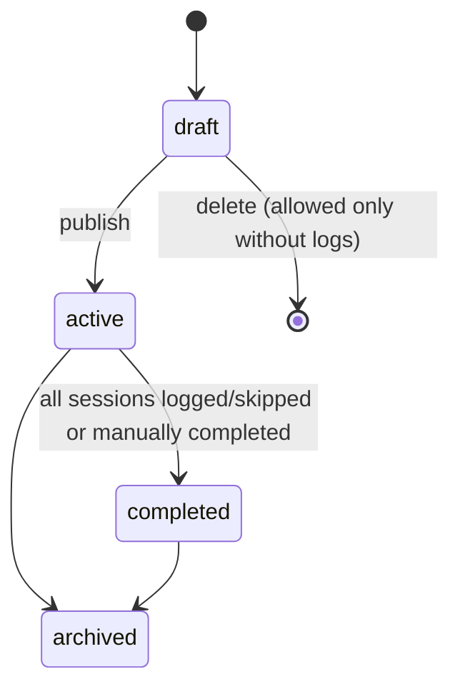

# Training programs

Entities: `Program`, `Block`, `Week`, `TrainingSession` ([data_model.md](../01_architecture/data_model.md#programming-planned)). Exercise-level prescription rules are in [exercises_and_prescriptions.md](exercises_and_prescriptions.md).

## Hierarchy

```
Program            "Spring 2027 meet prep"           (one athlete)
└─ Block           "Block 2 – Strength"              goal: build top-end strength
   └─ Week         "Week 3"
      └─ TrainingSession "Day 1 – Heavy squat"        optional date: 2027-03-02
         └─ ExercisePrescription  #1 Competition Squat, rest 4 min
            └─ PrescribedSet      1×3 @ RPE 8 (top), 3×5 @ 75%
```

**Decision:** the training session is a separate entity ([ADR-005](../00_meta/decision_log.md#adr-005-training-session-as-an-entity)). It is the unit the athlete starts and completes, the unit videos and feedback attach to, and the unit that carries an optional date. No existing code had to be reconciled with this model.

## Program lifecycle



- `draft` is visible to the author only. The athlete cannot see a draft their coach is building.
- `active` is visible to the athlete and can be logged.

## Business rules

| ID | Rule | Status |
| --- | --- | --- |
| BR-PRG-001 | A program belongs to exactly one athlete ([Q-008](../00_meta/open_questions.md#q-008-program-ownership-and-templates)). | [Proposed] |
| BR-PRG-002 | An athlete has at most one `active` program. Publishing a new one asks whether to complete or archive the current one. | [Proposed] |
| BR-PRG-003 | Blocks, weeks, sessions, and prescriptions are ordered by `position`. Reordering never changes IDs, so links from logs, videos, and feedback stay valid. | [Proposed] |
| BR-PRG-004 | A week may contain sessions with or without dates ([Q-018](../00_meta/open_questions.md#q-018-scheduling-model)). | [Proposed] |
| BR-PRG-005 | The author can duplicate a week (within a block, or into another block or program for the same coach's athletes). Duplication copies prescriptions only, never logs. | [Proposed] |
| BR-PRG-006 | Once a session has a `SessionLog`, its prescriptions are **locked** (no edits to exercises or sets in that session) ([Q-013](../00_meta/open_questions.md#q-013-editing-prescriptions-after-logging-starts)). Session coach notes remain editable. | [Proposed] |
| BR-PRG-007 | A program, block, week, or session that has any `SessionLog` cannot be deleted. It can only be archived (program level). | [Proposed] |
| BR-PRG-008 | Editing future, unlogged sessions of an `active` program is allowed and takes effect immediately for the athlete. | [Proposed] |
| BR-PRG-009 | The "current week" is the earliest week (by block and week position) that contains a session without a `SessionLog`. When every session has a log, the program is complete. | [Proposed] |
| BR-PRG-010 | Only the author (or the athlete's active coach) edits prescriptions. A coached athlete cannot edit prescriptions their coach wrote. | [Requirement] |

## Program changes, missed sessions, and history

- **Changing the plan mid-block.** The coach edits sessions that have not been logged. Logged sessions are frozen, so history shows exactly what was prescribed when the athlete trained.
- **Missed sessions.** A session with a `scheduled_date` in the past and no log is shown as *missed* (derived, not stored). The athlete can still log it late (logging records the actual `started_at`) or mark it `skipped`. The coach can reschedule it by changing `scheduled_date` while it has no log.
- **Sessions without dates.** These are never "missed". They are simply the next sessions in order.
- **Skipping a whole week.** The athlete or coach marks each session in the week `skipped`. [Open] A bulk "skip week" action is a UX enhancement, not an MVP requirement.
- **Archived programs** remain fully readable in history. They are read-only.

## Edge cases

- The coach deletes an exercise prescription from a future session after the athlete uploaded a video for it. This cannot happen: a video upload requires a session log, and a session log locks the session (BR-PRG-006).
- The coach reorders weeks after week 1 is logged. The reorder is allowed. BR-PRG-009 recomputes the current week, so the athlete's logged history is unaffected.
- The athlete is self-coached and later gains a coach. The coach can edit the athlete's active program (BR-USR-008 / authorization model).
