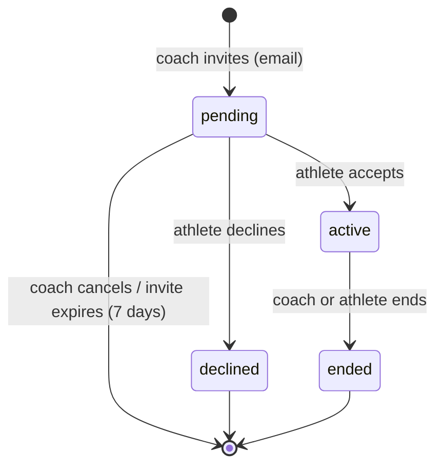

# Users and relationships

Entities: `User`, `Profile`, `AthleteProfile`, `CoachProfile`, and `CoachAthleteRelationship` ([data_model.md](../01_architecture/data_model.md#identity)). Enforcement is in [authentication_and_authorization.md](../01_architecture/authentication_and_authorization.md).

## Concepts

- **Identity vs. role.** A `User` is a login. Roles exist only through profiles: an `AthleteProfile` makes the user an athlete, and a `CoachProfile` makes the user a coach. A user can have both.
- **Training data belongs to the athlete profile**, not to the coach. When a coach leaves, the athlete keeps all their programs, logs, and videos.
- **The relationship is the access grant.** A coach sees an athlete's data only while their relationship is `active`.

## Relationship lifecycle

A new invitation creates a new relationship row. Ended and declined rows are kept for history.

## Business rules

| ID | Rule | Status |
| --- | --- | --- |
| BR-USR-001 | A user must have at least one role after onboarding. Roles can be added later from settings. | [Proposed] |
| BR-USR-002 | Removing a role is not supported in the MVP (it would orphan data). | [Proposed] |
| BR-USR-003 | Only a user with a coach profile can invite athletes. | [Requirement] |
| BR-USR-004 | An invitation targets an email address. If no account exists for it, the invitee signs up and then accepts. | [Proposed] |
| BR-USR-005 | An athlete has at most one `active` coach ([Q-003](../00_meta/open_questions.md#q-003-multiple-coaches-per-athlete)). Accepting a second invitation requires ending the current relationship first. | [Proposed] |
| BR-USR-006 | A coach cannot invite themselves. Dual-role users coach themselves through self-coaching, not a relationship. | [Proposed] |
| BR-USR-007 | Either party can end an active relationship at any time. The coach loses access immediately ([Q-015](../00_meta/open_questions.md#q-015-former-coach-access)). | [Proposed] |
| BR-USR-008 | Ending a relationship does not delete or modify programs, logs, videos, or feedback. Programs the coach authored stay with the athlete and become athlete-editable. | [Proposed] |
| BR-USR-009 | A coach's roster lists athletes with `active` relationships. Pending invitations are listed separately. | [Requirement] |
| BR-USR-010 | A coach sees an athlete's display name and avatar. The athlete's email is visible to the coach only for their own invitations. | [Proposed] |

## Examples and edge cases

- **Coach who also trains.** User Alex has both profiles. Alex's dashboard shows the roster (coach panel) and Alex's own current program (athlete panel). Alex writes that program as a self-coached athlete.
- **Athlete changes coach.** Athlete A ends the relationship with Coach X and accepts Coach Y. Coach Y sees A's full history, including programs written by X. This is intended: history belongs to the athlete. X sees nothing.
- **Invite to an existing athlete with a coach.** The invite is created as `pending`. When the athlete tries to accept, they are told to end their current relationship first (BR-USR-005).
- **Invite email mismatch.** Someone signed in as another email opens the invite link. The invite is rejected (SEC-012).
