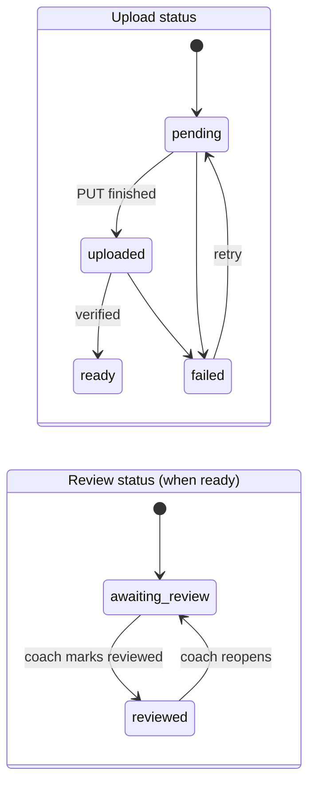

# Video review and feedback

Entities: `Video`, `VideoPerformedSet`, `FeedbackComment`, `ThreadReadMarker` ([data_model.md](../01_architecture/data_model.md#review)). Storage, upload, and playback mechanics are in [video_storage_and_delivery.md](../01_architecture/video_storage_and_delivery.md).

## Concepts

- A **video** always belongs to one athlete and one training session. It *should* reference the exercise prescription it shows, and *may* reference the specific performed sets.
- **Feedback** is a comment attached to a video, to an exercise prescription, or to both. Comments form a flat thread per video or per prescription ([Q-017](../00_meta/open_questions.md#q-017-feedback-threading-and-review-status)).
- **Review status** tracks the coach's workflow (`awaiting_review` → `reviewed`). It is separate from the comments.

## Statuses

## Business rules

| ID | Rule | Status |
| --- | --- | --- |
| BR-VID-001 | Only the athlete uploads videos, and only for sessions in their own `active` or `completed` programs that have a `SessionLog`. | [Proposed] |
| BR-VID-002 | A video must reference a training session. It should reference an exercise prescription (the UI requires one, unless the athlete selects "General / whole session"). | [Proposed] |
| BR-VID-003 | Linked performed sets must belong to the same session and prescription. | [Proposed] |
| BR-VID-004 | Accepted types are `video/mp4` and `video/quicktime`. The maximum size is 500 MB ([Q-016](../00_meta/open_questions.md#q-016-video-retention-and-limits)). | [Proposed] |
| BR-VID-005 | Without an active coach, the UI does not show review status, and videos serve as personal reference. A new coach's review queue contains only videos uploaded after the relationship started. Older videos are visible in history ([Open]: confirm). | [Proposed] |
| BR-VID-006 | Only the active coach can change the review status. Posting a comment does not change it (Q-017). | [Proposed] |
| BR-VID-007 | Both the athlete and the active coach can comment. Authors can edit their own comments (with `edited_at` shown) and delete them (shown as "comment deleted"). | [Proposed] |
| BR-VID-008 | Comments may carry a `video_timestamp_seconds`. Clicking it seeks the player. | [Proposed] |
| BR-VID-009 | Feedback history is ordered by `created_at` and is never reordered or silently rewritten. | [Requirement] |
| BR-VID-010 | The athlete can delete their own videos at any time. Comments remain, attached to a "video deleted" placeholder. | [Proposed] |
| BR-VID-011 | Authorization for video metadata, comments, and playback URLs uses the same `read` check on the athlete (AUTH-005). | [Requirement] |
| BR-VID-012 | Unread state is per user per thread. Opening a thread marks it read (F-10). | [Proposed] |

## Workflow example

1. The athlete logs Week 3 Day 1 and uploads a video of the squat top set (170 × 3), linked to set 1.
2. The video appears in the coach's **Awaiting review** queue with athlete, session, exercise, and set context.
3. The coach watches it and comments at 0:04 ("knees cave on the ascent") and at 0:07, then marks the video reviewed.
4. The athlete's dashboard shows "1 new feedback". The athlete opens the thread and replies, and the unread badge clears.
5. The coach sees the reply as unread in the activity feed (F-10). The video stays `reviewed` until the coach reopens it.

## Edge cases

- **The relationship ends while videos are awaiting review.** They disappear from the former coach's queue (access revoked). The athlete keeps the videos and all comments.
- **Upload succeeds but confirm never arrives** (the tab was closed). The video stays `pending` and is invisible to the coach. The cleanup job removes it (or the athlete retries).
- **Unplayable codec.** A fallback message appears with a download link ([video_storage_and_delivery.md](../01_architecture/video_storage_and_delivery.md#playback-compatibility)).
