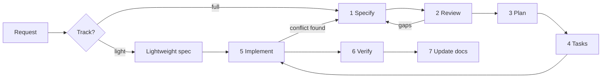

# Specification workflow

Covers stages 1–4 of the feature lifecycle: **Specify → Review → Plan → Task breakdown**. Stages 5–7 are in [implementation_workflow.md](implementation_workflow.md).



## Choosing a track

| Track | Use when | Artifacts |
| --- | --- | --- |
| **Full** | Any of: a data model or migration change, authorization or permission change, video upload or storage, more than one layer (UI + action + DAL), a new dependency, or a change to an existing business rule | `spec.md`, `plan.md`, `tasks.md`, `acceptance_criteria.md` |
| **Lightweight** | Copy or styling fixes, a bug fix with an obvious cause that changes no rule, a refactor without behavior change, or a single-component UI tweak | One `spec.md` with only: problem, change, acceptance criteria, verification. Or, for trivial fixes, a short note in the task or PR |

If unsure, use the full track.

## Feature folder

```
spec/features/F-05-set-logging/
  spec.md                 what and why (source of truth for behavior)
  plan.md                 how
  tasks.md                ordered steps
  acceptance_criteria.md  Given/When/Then, traced to FR/BR
```

Copy from [features/_template/](../features/_template/). The folder name is `F-<two-digit backlog id>-<kebab-name>`.

## Stage 1: Specify

- State the user problem and user stories. Do not start from a solution.
- Write functional requirements (`FR-001`…) and feature-specific business rules (`BR-001`…). Reference the global domain rules (for example `BR-LOG-003`) instead of copying them.
- Define every UI state (loading, empty, error, success, locked).
- List permissions explicitly against the [permission matrix](../01_architecture/authentication_and_authorization.md#permission-matrix).
- Each requirement must be testable. "Fast" or "intuitive" is not a requirement. "Logging a set as prescribed takes one tap" is.
- Uncertain points go in **Unresolved questions**. Do not silently decide them.
- Set the status to `Draft`.

## Stage 2: Review

Check the spec against this list and record the findings in the spec's *Review notes* section:

- [ ] Every FR has at least one AC, and every AC traces to an FR or BR.
- [ ] No contradiction with [03_business_domain/](../03_business_domain/) or accepted decisions.
- [ ] Authorization is specified for every read and write.
- [ ] Edge cases are covered: empty data, concurrency or double submit, a relationship ending mid-flow, a locked session, large inputs, and slow networks.
- [ ] Dependencies on other features and on open questions are listed.
- [ ] Security and privacy implications are considered ([security.md](../02_coding_standards/security.md)).

Blocking open questions must be answered (or a documented default accepted) before the status becomes `Approved`. **The project owner approves specs.** Claude may propose approval but must not mark a full-track spec `Approved` on its own.

## Stage 3: Plan

Fill in [plan.md](../features/_template/plan.md). The plan explains *how* to satisfy the spec. It must not add, drop, or change requirements. If planning reveals a spec problem, go back to Stage 1 and update the spec first.

## Stage 4: Task breakdown

Fill in [tasks.md](../features/_template/tasks.md):

- Each task is small (roughly one focused session), independently verifiable, and leaves the app building.
- Order: schema/migration → DAL + authorization tests → actions → UI → E2E.
- Each task lists the FR/AC IDs it addresses and a definition of done.

## Spec statuses

`Draft` → `In review` → `Approved` → `In progress` → `Implemented` (verified) → optionally `Superseded`.

## Changing an approved spec

Edit the spec, add an entry to its *Change log* section with the date and reason, and re-review the affected ACs and tasks. Never change behavior in code without updating the spec in the same change.
