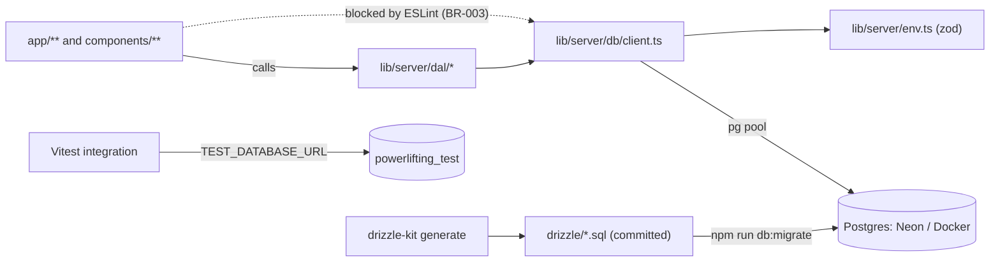

# F-00 Platform foundation: implementation plan

| Field | Value |
| --- | --- |
| Spec | [spec.md](spec.md) (must be `Approved` before implementation) |
| Status | Draft |
| Last updated | 2026-10-10 |

> This plan describes **how** to satisfy the spec. It must not add, remove, or change requirements. If it needs to, update the spec first.

## 1. Proposed solution

Add the smallest set of tools that give every later feature a database, tests, and guard rails:

- **Database:** PostgreSQL through `pg` and Drizzle ORM. One module (`lib/server/db/client.ts`) owns the connection pool.
- **Migrations:** drizzle-kit generates SQL files into `drizzle/`. A small script applies them using Drizzle's migrator, so deployed environments need no extra tooling.
- **Local and CI database:** one Docker Compose service (`postgres:17`) with two databases, `powerlifting_dev` and `powerlifting_test`. CI uses a GitHub Actions service container instead of Compose.
- **Tests:** Vitest with two projects, `unit` (no database) and `integration` (real Postgres, single worker). Playwright for the browser smoke test.
- **Guard rails:** Zod-validated env, `server-only` on every module under `lib/server/`, an ESLint `no-restricted-imports` rule, and a test-database safety check.

This satisfies FR-001 to FR-015 without adding any domain table.

## 2. Architecture and data flow

Migration flow: edit schema in `lib/server/db/schema/` → `npm run db:generate` → review and commit the SQL → `npm run db:migrate`.

## 3. Data model changes

| Table | Change | Constraint / index | Migration notes |
| --- | --- | --- | --- |
| (none) | No domain tables | n/a | One **baseline migration** generated with `drizzle-kit generate --custom --name=baseline`. It contains only a comment. It proves that generate, apply, and the history table work. Risk: Drizzle's migrator may need at least one statement. Fallback: `SELECT 1;`. Verified in T-04. |

Conventions fixed here for later features:

- `text` + `CHECK` for statuses (BR-004, Unresolved #2).
- UUID primary keys generated by the database with `gen_random_uuid()` (DB-003).
- Column types per DB-005. Better Auth manages its own tables in F-01, and the F-01 plan must reconcile its string ids with DB-003.

## 4. API / server-side changes

| Kind | Name | Input | Authorization | Returns / errors |
| --- | --- | --- | --- | --- |
| DAL read | `pingDatabase()` in `lib/server/dal/system.ts` | none | None. It touches no athlete data (spec §8). Never exposed through a route. | `{ ok: boolean }`. Never throws and never includes the connection string. |
| Type | `ActionResult<T>` in `lib/server/action-result.ts` | n/a | n/a | Discriminated union from [api_and_data_access.md](../../01_architecture/api_and_data_access.md) |
| Module | `getEnv()` in `lib/server/env.ts` | `process.env` | n/a | Parsed, typed env. Throws `ENV_INVALID` naming the variable, never the value. |
| Module | `db` in `lib/server/db/client.ts` | `DATABASE_URL` | n/a | Drizzle instance. Lazy: the pool is created on first use, so `next build` never needs a database. |

No Server Actions and no Route Handlers.

**No caching.** Nothing in `lib/server/` uses `use cache` (ADR-019).

## 5. UI changes

None. The Playwright smoke test loads `/sign-in` (the root route is still the Next.js template).

## 6. Authorization considerations

No athlete data is read or written. The rules F-00 puts in place for later features:

- **BR-003 / DB-020:** the ESLint rule. Allowed importers of the DB layer: `lib/server/db/**`, `lib/server/dal/**`, `lib/server/auth/**`, `drizzle.config.ts`, scripts, and test files. Forbidden everywhere else, including `app/**` and `components/**`.
- **`server-only`:** a second, independent barrier. Even if lint is bypassed, a client bundle that reaches `lib/server` fails to build.
- The lint rule is proven by a test (AC-011), so it cannot silently stop working.

## 7. Migration and compatibility

Greenfield: no existing data and no existing migrations. Destructive changes: none. `.gitignore` gains `!.env.example` (the `.env*` rule would otherwise hide it). `package.json` gains `engines.node` (`>=22`). The local dev environment is Node 24, and CI uses 24.

Rollout order: local tooling first (T-01 to T-08), then CI (T-09), then docs (T-10). Neon is not touched by F-00. The owner runs `npm run db:migrate` against it manually when F-01 needs tables (Unresolved #7).

## 8. Testing strategy

| Level | What | Covers AC |
| --- | --- | --- |
| Unit | Env validation (missing, malformed, secret not echoed). One sample test of existing pure code (`lib/domain/format.ts`) to prove the runner works. | AC-003, AC-005 |
| Integration (real DB) | Migrations apply and repeat. `pingDatabase` returns ok. Table-emptying helper. Safety guard rejects a non-`_test` database. | AC-002, AC-004, AC-006, AC-007 |
| Lint test | Run ESLint's `lintText` on fixture strings: a component importing the DB client must error, and a DAL file importing it must not. | AC-011 |
| E2E | Playwright: `/sign-in` renders its heading and form. | AC-008 |
| Build check | A throwaway client component importing a `lib/server` module fails `next build`. Run once and recorded. | AC-012 |
| CI | The workflow itself on a pull request. | AC-013 |
| Manual | Fresh-checkout walkthrough of the README, and the `.env.example` review. | AC-001, AC-010, AC-014 |

Integration details:

- Vitest `integration` project: `pool: forks`, one worker, so tests cannot interleave on one database.
- Global setup reads `TEST_DATABASE_URL`, runs the safety check, then runs the migrations once.
- `resetDatabase()` truncates all tables in the `public` schema (except the migration history) with `RESTART IDENTITY CASCADE`. Called in `beforeEach` by tests that write. This satisfies TST-003 (a freshly emptied schema).
- A Vitest alias maps `server-only` to an empty stub, because the real package throws outside a React Server environment.
- The `@/` path alias is configured in `vitest.config.ts` by hand, with no plugin.

## 9. Risks and alternatives

| Risk / alternative | Assessment | Decision |
| --- | --- | --- |
| Neon HTTP driver instead of `pg` | Cannot run interactive transactions, which DB-023 requires. | Rejected (Unresolved #1) |
| Neon WebSocket driver | Does not talk to a plain local Postgres, so dev and prod would diverge. | Rejected |
| `pg` pools on Vercel Fluid compute can hold idle connections | Real risk. Use Neon's pooled URL and a small `max`. Check Vercel's current guidance in T-03 and record any extra package first. | Mitigate in T-03 |
| Postgres enums | Painful to change inside transactions. | Use `text` + `CHECK` (BR-004) |
| Prisma, Testcontainers | Rejected earlier (ADR-007). Testcontainers adds a dependency that Docker Compose already covers. | Rejected |
| Dev-server test runs against production by mistake | High impact. Guard in FR-008, separate `TEST_DATABASE_URL`, CI container only. | Mitigated, tested (AC-007) |
| Playwright browser download slows CI | Cache `~/.cache/ms-playwright`. Chromium only. | Accepted |
| `npm run build` at CI time without a database | Pool is lazy, so the build needs no DB. Verified in AC-009 on a checkout with no `.env.local`. | Accepted |
| Baseline migration that contains only a comment may not apply | See §3. Fallback `SELECT 1;`. | Verify in T-04 |
| Better Auth uses string ids, DB-003 says UUID | Not an F-00 problem. Noted for the F-01 plan. | Deferred to F-01 |

## 10. New dependencies

| Package | Why it is needed | Alternatives considered |
| --- | --- | --- |
| `drizzle-orm` | Query builder and migrator (ADR-007). Better Auth's adapter requires it (peer `^0.45.2`). | Prisma, raw SQL (rejected in ADR-007) |
| `pg` + `@types/pg` (dev) | Postgres driver that works with Neon's pooled URL, local Docker, and CI. | `postgres` (postgres.js), Neon serverless driver (see §9) |
| `drizzle-kit` (dev) | Generates SQL migrations from the TypeScript schema (DB-001, DB-010). | Hand-written SQL |
| `zod` | Environment validation now, and the shared input schemas later ([api_and_data_access.md](../../01_architecture/api_and_data_access.md)). | Hand-rolled checks |
| `server-only` | Build-time guard that keeps `lib/server` out of client bundles. | Lint alone (weaker) |
| `vitest` (dev) | Unit and integration runner (ADR-017). | Jest |
| `@playwright/test` (dev) | End-to-end runner (ADR-017). | Cypress |

Not added, on purpose: `dotenv` (Node loads `.env.local` with `process.loadEnvFile`), `tsx` (scripts are plain `.ts` run by Node 24's built-in TypeScript support, or `.mjs` if that proves flaky), `vite-tsconfig-paths`, `eslint-plugin-boundaries`, `@vercel/functions` (only if T-03 says it is needed), Testcontainers.

## 11. Files and modules likely affected

New:

- `compose.yaml`, `docker/postgres-init.sql` (creates the second database)
- `drizzle.config.ts`, `drizzle/` (generated SQL), `scripts/migrate.ts`
- `lib/server/env.ts`, `lib/server/action-result.ts`
- `lib/server/db/client.ts`, `lib/server/db/schema/index.ts`
- `lib/server/dal/system.ts`
- `vitest.config.ts`, `tests/setup/` (global setup, safety guard, reset helper, `server-only` stub)
- `playwright.config.ts`, `tests/e2e/smoke.spec.ts`
- `tests/lint/db-import-rule.test.ts`
- `.github/workflows/ci.yml`, `.env.example`, `.nvmrc`

Changed:

- `package.json` (scripts, dependencies, `engines`), `package-lock.json`
- `eslint.config.mjs` (restricted-imports rule)
- `.gitignore` (`!.env.example`, Playwright output folders)
- `README.md` (setup), `spec/02_coding_standards/{database_and_data_access,testing}.md`, `spec/05_project_memory/*`, decision log
