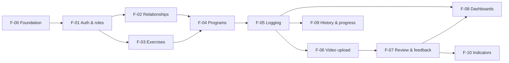

# Feature backlog

Features move through the lifecycle in [specification_workflow.md](../04_workflows/specification_workflow.md) and [implementation_workflow.md](../04_workflows/implementation_workflow.md). Current status is tracked in [implementation_status.md](../05_project_memory/implementation_status.md).

**No full specifications exist yet.** No feature is implemented, and every feature depends on at least one open infrastructure decision. Specs are written just in time, starting with F-00 and F-01. Create a folder `F-NN-<name>/` from [_template/](_template/) when a feature enters Stage 1.

Priority: **P0** = required before any user value, **P1** = MVP core, **P2** = MVP completeness, **P3** = after the MVP.

## Dependency graph

## Phase 0: Foundation

### F-00 Platform foundation · P0

- **Scope:** git repository, database plus migrations, test tooling, `typecheck`/`test` scripts, `.env.example`, DAL skeleton and lint import restriction, CI (if hosting is decided), and seeding infrastructure.
- **Depends on:** nothing.
- **Unresolved:** [Q-001](../00_meta/open_questions.md#q-001-database-and-hosting), [Q-002](../00_meta/open_questions.md#q-002-orm--query-layer), [Q-006](../00_meta/open_questions.md#q-006-hosting-platform), [Q-007](../00_meta/open_questions.md#q-007-testing-tools). Choice of component primitives ([styling_and_components.md](../02_coding_standards/styling_and_components.md#component-library-open)).
- Not in the requested backlog, but every other feature needs it. Added for that reason.

## Phase 1: Accounts and access

### F-01 Authentication and role-based access · P0

- **Scope:** sign-up, sign-in, sign-out, email verification, password reset, onboarding role selection, `Profile`/`AthleteProfile`/`CoachProfile`, `getCurrentUser`, `proxy.ts` optimistic redirect, and the `(app)` shell.
- **Depends on:** F-00.
- **Unresolved:** [Q-004](../00_meta/open_questions.md#q-004-authentication-provider) (provider), [Q-019](../00_meta/open_questions.md#q-019-role-selection-and-coach-verification) (role selection), and the rate-limiting mechanism.

### F-02 Coach-athlete relationships and roster · P1

- **Scope:** invite by email, accept or decline, end a relationship, the roster page, and the `canAccessAthlete` primitive with full authorization tests.
- **Depends on:** F-01.
- **Unresolved:** [Q-003](../00_meta/open_questions.md#q-003-multiple-coaches-per-athlete), [Q-015](../00_meta/open_questions.md#q-015-former-coach-access), and invitation email delivery (uses Resend, [ADR-018](../00_meta/decision_log.md#adr-018-resend-for-email)).

## Phase 2: Programming and logging (MVP core)

### F-03 Exercise library and variations · P1

- **Scope:** system exercise seed, custom exercises, variations (one level), archive, and the exercise picker. `AthleteMax` recording.
- **Depends on:** F-01.
- **Unresolved:** the final seed list, and whether variations count toward primary-lift progress ([exercises_and_prescriptions.md](../03_business_domain/exercises_and_prescriptions.md#exercise-library)).

### F-04 Program, block, week, session, and prescription management · P1

- **Scope:** CRUD and reordering across the hierarchy, prescribed set editor, duplicate week, draft/active/archived lifecycle, %1RM resolution display, and locking.
- **Depends on:** F-02 (coach authoring) and F-03. Self-coached authoring only needs F-01 and F-03.
- **Unresolved:** [Q-008](../00_meta/open_questions.md#q-008-program-ownership-and-templates), [Q-013](../00_meta/open_questions.md#q-013-editing-prescriptions-after-logging-starts), [Q-018](../00_meta/open_questions.md#q-018-scheduling-model), [Q-012](../00_meta/open_questions.md#q-012-weight-units), and %1RM rounding.

### F-05 Athlete training execution and set-level logging · P1

- **Scope:** session view on mobile, log/skip/extra sets, substitution, notes, start/complete/skip session, deviation display, local draft persistence, and the edit window.
- **Depends on:** F-04.
- **Unresolved:** [Q-011](../00_meta/open_questions.md#q-011-offline-logging), and the length of the edit window (BR-LOG-007).

## Phase 3: Video review

### F-06 Secure exercise video uploads · P1

- **Scope:** presigned direct upload, progress, retry, confirm, metadata, playback via signed URL, deletion, and the stale upload cleanup.
- **Depends on:** F-05 (videos attach to logged sessions and sets).
- **Unresolved:** [Q-005](../00_meta/open_questions.md#q-005-video-object-storage), [Q-009](../00_meta/open_questions.md#q-009-video-transcoding), [Q-016](../00_meta/open_questions.md#q-016-video-retention-and-limits), and the cron mechanism.

### F-07 Coach video review and exercise-specific feedback · P1

- **Scope:** review queue, player with timestamped comments, feedback threads on videos and prescriptions, athlete replies, and the mark reviewed/reopen action.
- **Depends on:** F-06. Feedback on prescriptions alone only needs F-05.
- **Unresolved:** [Q-017](../00_meta/open_questions.md#q-017-feedback-threading-and-review-status).

## Phase 4: Oversight and insight

### F-08 Athlete and coach dashboards · P2

- **Scope:** the MVP widgets in [dashboards_and_progress.md](../03_business_domain/dashboards_and_progress.md), with real data only.
- **Depends on:** F-05 and F-07 (widgets ship as their data becomes available).
- **Unresolved:** the "current week" definition ([Q-018](../00_meta/open_questions.md#q-018-scheduling-model)).

### F-09 Training history and progress tracking · P2

- **Scope:** session history (prescribed vs performed), per-exercise history, e1RM trend for the primary lifts, and "set as max".
- **Depends on:** F-05.
- **Unresolved:** [Q-014](../00_meta/open_questions.md#q-014-e1rm-formula), and the chart library (a new dependency that must be justified).

### F-10 Notifications and outstanding review indicators · P2

- **Scope:** `ThreadReadMarker`, unread counts in navigation and dashboards, and the awaiting-review count.
- **Depends on:** F-07.
- **Unresolved:** [Q-010](../00_meta/open_questions.md#q-010-notification-channels). Email notifications are P3.

## Later (P3, not specified)

Program templates, multiple coaches or teams, email notifications, transcoding, resumable uploads, offline sync, a pound-first UI, compliance analytics, and an account deletion flow (required before a public launch).
