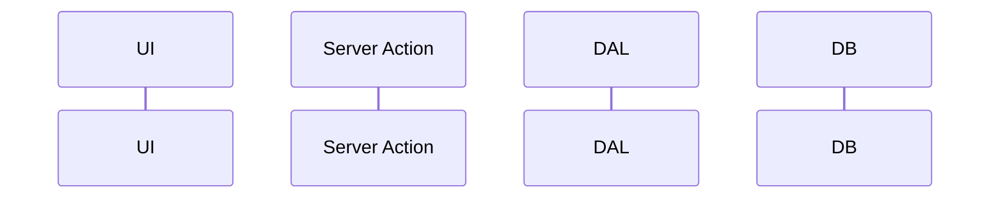

# F-NN Feature name: implementation plan

| Field | Value |
| --- | --- |
| Spec | [spec.md](spec.md) (must be `Approved`) |
| Status | Draft / Approved |
| Last updated | YYYY-MM-DD |

> This plan describes **how** to satisfy the spec. It must not add, remove, or change requirements. If it needs to, update the spec first.

## 1. Proposed solution

A short description of the approach and why it satisfies the FRs.

## 2. Architecture and data flow

## 3. Data model changes

| Table | Change | Constraint / index | Migration notes |
| --- | --- | --- | --- |

## 4. API / server-side changes

| Kind | Name | Input (schema) | Authorization | Returns / errors |
| --- | --- | --- | --- | --- |
| DAL read | | | | |
| DAL write | | | | |
| Server Action | | | | |
| Route Handler (only if external) | | | | |

## 5. UI changes

Routes, components (server or client), and state handling for each UI state in spec §9.

## 6. Authorization considerations

The rules applied (AUTH-*, permission matrix rows) and the tests that prove them.

## 7. Migration and compatibility

Backfills, destructive changes, rollout order, and the effect on existing data or history.

## 8. Testing strategy

| Level | What | Covers AC |
| --- | --- | --- |
| Unit | | |
| Integration (DB + authz) | | |
| E2E | | |
| Manual | | |

## 9. Risks and alternatives

| Risk / alternative | Assessment | Decision |
| --- | --- | --- |

## 10. New dependencies

| Package | Why it is needed | Alternatives considered |
| --- | --- | --- |

## 11. Files and modules likely affected

- `lib/server/db/schema/…`
- `lib/server/dal/…`
- `app/(app)/…`
- `components/…`
